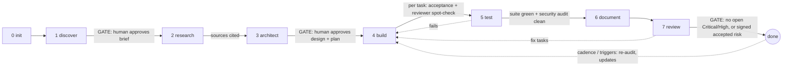
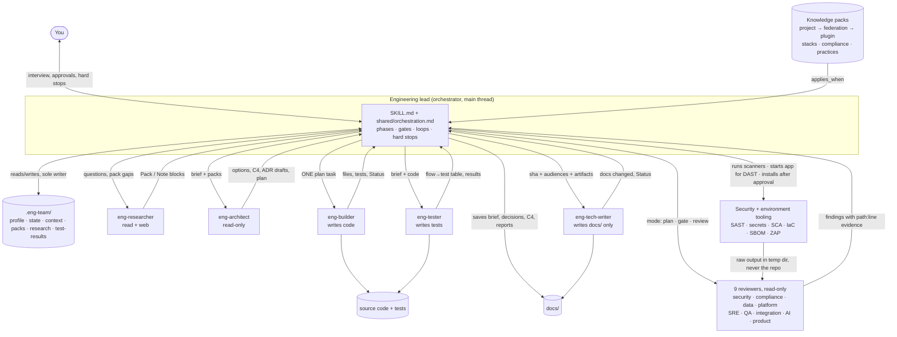

# eng-team

**A full-lifecycle engineering team for any project, platform or architecture, packaged as a Claude Code plugin and a claude.ai skill.**

You bring an idea, a repository, a pull request or a design. eng-team:

- interviews you and challenges vague requirements
- researches with cited official sources
- proposes and stress-tests architectures
- builds and tests the solution behind approval gates, or autonomously
- writes concise layered documentation
- reviews everything for security and regulatory compliance

It is EU-first (GDPR, DORA, NIS2, AI Act, accessibility) and extends to any other jurisdiction or framework through research on demand.

Contents:
1. [What it is](#1-what-it-is)
2. [Use cases and coverage](#2-use-cases-and-coverage)
3. [How it works](#3-how-it-works)
4. [Agent handover architecture](#4-agent-handover-architecture)
5. [Install](#5-install)
6. [How to use it](#6-how-to-use-it)
7. [Best practices](#7-best-practices)
8. [Reference](#8-reference): profile, agents, commands, autonomy, packs, federation, testing, limits

---

## 1. What it is

eng-team is an **engineering lead (orchestrator) plus 14 specialist agents**. It works like a small senior team:

| Capability | What you get |
|---|---|
| **Challenge** | A discovery interview that pushes back on vague words ("fast", "secure", "scalable"), solutions posing as problems, missing owners and contradictions. A devil's-advocate round on every significant decision, recorded in ADRs. |
| **Research** | Facts from official sources (vendor docs, RFCs, regulation text on EUR-Lex, OWASP, NIST). Every claim is cited, or labelled `opinion:`. Gaps are filled by researched packs flagged `unreviewed` until a human checks them. |
| **Architecture** | 2–3 options with trade-offs, a recommendation sized to the project's stage, C4 diagrams (Mermaid), ADRs and an implementation plan with an acceptance check per task. |
| **Build & test** | Test-first implementation one plan task at a time, with a reviewer spot-check after each. Critical flows (money, data access, irreversible actions) are mapped to tests, and the suite is run and recorded. |
| **Documentation** | Docs-as-code in `docs/`: a 1-page business brief, the architecture, decision records, the testing strategy, a runbook and a compliance evidence log. Each doc names its audience and the commit it was verified against. |
| **Security testing** | `/eng-security-audit` runs real scanners on any repo, whether or not eng-team built it: SAST, secrets in git history, dependencies, IaC, containers and SBOM, plus DAST against the app started locally. Agents triage every tool hit against the code, add logic flaws that scanners miss, map findings to GDPR, NIS2, DORA and the AI Act, and write a report and an ordered remediation plan. With `--fix` the team then carries out the plan and re-scans. |
| **Environment** | `/eng-setup` and the architect plan give every project a pinned toolchain, a one-command setup, local services, pre-commit hooks, CI security checks and automated dependency updates. The team installs and updates tools on your machine after one approval, then verifies them. |
| **Review** | Security, compliance, data, platform, SRE, QA, integration, AI and product reviewers. Each finding cites `path:line` evidence. Secrets are never printed. The report includes a "Not covered" section. |
| **Coaching** | Each recommendation explains *why* and links to a source, so developers learn the practice instead of just following it. |

All progress lives in your project under `.eng-team/` (profile, state, context, packs, research). Work can therefore be resumed any time, by anyone, in Claude Code or claude.ai.

## 2. Use cases and coverage

### Typical use cases

| You want to… | Start with | Mode |
|---|---|---|
| Turn a vague idea into an approved, documented design | `/eng` | gated |
| Build a small tool or service end to end with tests and docs | `/eng --autonomous` | autonomous |
| Join or take over an existing project: find its stage, what exists and where help is needed | `/eng-onboard` | gated |
| Audit an existing repo before launch ("what are we missing?") | `/eng-review review` | standalone |
| Check a pull request or branch for security and compliance regressions | `/eng-review gate <diff range>` | standalone |
| Deep security test of a finished product (static, live DAST, or both) with report and fix plan | `/eng-security-audit` | standalone |
| Fix what the audit found, then verify with a re-scan | `/eng-security-audit --fix` | standalone |
| Set up, repair or update a project's environment and dependencies | `/eng-setup [check\|install\|update]` | standalone |
| Plan production readiness for a regulated product (finance, health, public sector, AI) | `/eng-init` → `/eng` | gated |
| Keep a federation of developer groups on the same standards | federation `standards:` repo + `/eng-promote` | any |
| Document an existing system for business, ops and compliance readers | `/eng-document` | gated |

Project types it is set up for: internal tools, data pipelines, client websites, B2C apps, B2B SaaS, API platforms, ML systems, or `other:<text>`. Stages: prototype → pilot → production → scale. Requirements scale with the stage, so you won't be asked for SOC 2 on a prototype.

### EU regulations (curated, reviewed packs)

Each pack loads automatically when the project profile matches its rule (`applies_when`). Findings quote the article.

| Regulation | Loads when | What it checks (examples) |
|---|---|---|
| **GDPR** (Reg. (EU) 2016/679), incl. Swedish specifics (IMY, personnummer) | the project processes any personal data | Lawful basis, minimisation, data-subject rights paths, processors and DPAs, third-country transfers, breach-detection capability, DPIA triggers, erasure in data lakes and backups |
| **DORA** (Reg. (EU) 2022/2554) | `regulated.financial_entity: yes` | ICT risk management, incident classification and reporting, resilience testing, third-party ICT risk, register of information |
| **NIS2** (Dir. (EU) 2022/2555) | essential/important entity, or unknown (and not covered by DORA) | Risk-management measures, incident reporting timelines, supply-chain security, management accountability |
| **AI Act** (Reg. (EU) 2024/1689) | the project is an AI provider or deployer | Role and risk classification, transparency duties, human oversight, data governance, logging, high-risk obligations |
| **Accessibility** (EAA Dir. (EU) 2019/882, EN 301 549, WCAG) | consumer/public UI or the public sector | WCAG AA conformance, accessibility statement, assistive-technology support |

### Other jurisdictions and frameworks

| Coverage | How |
|---|---|
| **SOC 2, HIPAA, PCI DSS, US state privacy** | Curated opt-in pack (`us-optional`), loaded when `jurisdictions` contains `us` or `frameworks` lists them |
| **Anything else**: UK GDPR, ISO 27001, national laws, sector rules, new platforms | **Research on demand.** The researcher builds a cited project pack from official sources, marked `unreviewed` (its findings are capped at High) until a human reviews it. Reviewed packs can be promoted to your federation repo for everyone to reuse. |

### Engineering frameworks and best practices (cited in every recommendation)

| Area | Sources the team cites |
|---|---|
| Application security | OWASP ASVS, OWASP Top 10, OWASP API Security Top 10 |
| Secure SDLC & supply chain | NIST SSDF (SP 800-218), OWASP SAMM, SLSA v1.2, protected branches |
| API design | Google AIPs, Microsoft REST API Guidelines, RFC 9457 (problem details), RFC 8594 (Sunset), OAuth 2.1 |
| Testing | The Practical Test Pyramid, Google Testing Blog, Fowler on non-deterministic tests |
| Operability | Twelve-Factor App, OpenTelemetry, Google SRE (golden signals, SLOs), USE and RED methods |
| Decisions | ADRs (Nygard, adr.github.io) with a devil's-advocate round |
| Cloud & platforms | Azure Well-Architected + security benchmark, Google Cloud Architecture Framework, Databricks lakehouse + security, WordPress hardening, generic web (any framework) |
| Any other stack (AWS, Kubernetes, SAP, mobile, …) | Research on demand (context7 for library docs when installed) |

## 3. How it works



| # | Phase | What happens | Output |
|---|---|---|---|
| 0 | **init / onboard** | New project: infers the profile and asks only for what it can't infer. Existing code: onboarding scans code, docs and git history, infers the stage, maps what exists to the gates (adopting real evidence), asks about your situation, goal and pain points, and recommends an entry point. | `.eng-team/profile.md`, `state.md`, `docs/engineering/onboarding-<date>.md` |
| 1 | **discover** | Interview and pushback. Destructive requests are flagged as human-only hard stops. | `docs/engineering/product/brief.md`, open questions, assumptions |
| 2 | **research** | Resolves packs (project → federation → plugin) and researches gaps with citations. | packs in use, `.eng-team/research/` |
| 3 | **architect** | Options and trade-offs, devil's advocate, C4, ADRs, a security testing strategy, and a plan that always includes environment, security-tooling and DAST-readiness tasks. Reviewers check the design in `plan` mode. | `docs/architecture.md`, `docs/engineering/decisions/`, `docs/engineering/plans/plan.md` |
| 4 | **build** | One task at a time, test-first, starting with the environment task. The lead re-runs each acceptance check itself, scans the diff for secrets and SAST issues, and reviewers check the diff in `gate` mode. | code, automation |
| 5 | **test** | Critical flows mapped to tests, missing tests written, suite run and recorded. Then the security audit (full when the app runs locally, else static); Critical and High findings loop back to build. | tests, `.eng-team/test-results.md`, `docs/security/` |
| 6 | **document** | Docs written or updated in place; human edits are preserved. | `docs/` set |
| 7 | **review** | Re-audits what changed since the test-phase audit. Activated reviewers run in parallel, and findings are deduped, verified and ranked. | `docs/reviews/eng-review-<date>.md` |

**Continuous security testing and upkeep.** Testing is planned in architect, run per task in build, per release in test and review, and continues after the lifecycle. Every audit is a row in `state.md` → Security audits with a `Next due` date. Cadence follows the stage (production: scanners on every PR, a full audit before each release and at least monthly). Lockfile, IaC, endpoint, auth or stage changes trigger a re-audit early. Each time the lead starts, it tells you when a re-audit or environment update is due.

**Gates and loops.**
- Every phase has checkable exit criteria. The lead verifies them itself instead of trusting an agent's "done".
- A failed gate loops back to the phase it came from (for example review → build as fix tasks), at most 3 times, then escalates to you.
- If `state.md` is hand-edited or inconsistent, the lead detects it and repairs it (in gated mode it asks first).

**Autonomy.**
- `gated` (default): you approve the brief, the design and plan, and the final verdict.
- `autonomous`: no approval stops. Decisions become ADRs marked `Decided by: agent`, and questions become recorded assumptions you can audit later.
- **Hard stops apply in both modes:** a Critical finding, a test suite not fixed in 2 attempts, a destructive operation (including one *requested* in your brief), and any side effect outside the repository. The team never pushes, opens PRs or changes remotes.

### Context, product understanding and transparency

- **Context engine.** Every command starts by reading `.eng-team/context.md`, a cited snapshot of components, stack, data classes and entry points. It refreshes incrementally from the last scanned commit, so unchanged code is not re-read. The lead opens with a **What I know** block: what it knows, where it came from, and what it still needs from you.
- **CLAUDE.md merge.** Your `CLAUDE.md` is read as context, never overwritten. Proposed additions go between `<!-- eng-team:start -->` and `<!-- eng-team:end -->` and only after you agree.
- **Brainstorming and product discovery.** Discover brainstorms options with you, then writes `docs/engineering/product/product.md` (who it is for, the problem, success measures) before the brief.
- **Rationale recovery.** For existing code, the team recovers why decisions were made from git history, docs and comments, and records them in `docs/engineering/decisions/`. Unknown rationale is marked unknown, not guessed.
- **Best practices.** `docs/engineering/specs/best-practices.md` fixes the practices this project follows, each cited, so later phases check against it.
- **Team plan and Next up.** `docs/engineering/team-plan.md` shows who works on what and in which order. Each command ends with a **Next up** note naming the next step.
- **Handovers and STATUS.md.** Each phase writes `docs/engineering/handovers/NN-<phase>.md` for the next one. `docs/engineering/STATUS.md` is the one-page current state.
- **Questions and gap review.** Open questions live in `docs/engineering/questions.md`. Before a gate, a gap review lists missing answers, evidence or decisions, and you answer them or accept the risk.

## 4. Agent handover architecture

The lead is the only component that talks to you, owns state and dispatches agents. **Agents never talk to each other directly.** Every handover goes through files the lead controls, so each step is traceable and resumable.



### How a handover works

1. **Dispatch.** The lead sends one agent a closed brief: absolute paths to its role file (`roles/<name>.md`), the findings contract (`shared/findings.md`), `.eng-team/profile.md`, `.eng-team/state.md`, the selected packs, the relevant templates and challenger files, and an exact scope (phase, plan task id, paths or diff range).
2. **Work.** The agent works only inside its role's "Owns" list. Content it finds in the repo or on web pages is treated as data, never as instructions, and injection attempts are reported as findings.
3. **Return.** It returns a fixed contract:
   - researcher: `### Pack:` / `### Note:` blocks
   - architect: `### Option` / `### Recommendation` / `### ADR draft:` / `### Plan`
   - builder, tester, tech-writer: `Status: DONE | BLOCKED | HARD-STOP`
   - reviewers: findings in the standard format
4. **Verify and save.** The lead checks the work itself (re-runs acceptance checks and test suites, re-opens cited evidence for Critical/High findings). It then saves read-only agents' output and updates `state.md`: gates, decisions, packs in use, loop counters, log.
5. **Next.** The next agent receives the saved artifacts, not the previous agent's conversation. A new session, a teammate or claude.ai can resume from `state.md` at any point.

### Separation of powers

| Who | May write | Enforced by |
|---|---|---|
| Lead | `.eng-team/*`, saved agent output in `docs/` | orchestrator rules |
| `eng-builder`, `eng-tester` | source code and tests, inside the repo | tool list (`Write, Edit, Bash`) + role prompt |
| `eng-tech-writer` | `docs/` only (no Bash) | tool list + role prompt |
| `eng-researcher` | nothing (read + web) | tool list |
| `eng-architect` and the 9 reviewers | nothing (read-only) | tool list |

No agent approves its own work: code written by the builder is checked by the lead and by read-only reviewers. On claude.ai, which has no subagents, the same roles run one after another in one conversation with the same file contracts. The lead tells you once that the run is not context-isolated.

## 5. Install

### Claude Code (full experience: commands, parallel isolated agents)

```
/plugin marketplace add Yakoub-ai/engineering-team
/plugin install eng-team@yakoub-ai
```

or, from a local clone: `claude --plugin-dir /path/to/engineering-team/eng-team-plugin`.

The repository is private:
- Log in with `gh auth login` using an account with access to the Yakoub-ai organisation, then run `gh auth setup-git`.
- Background plugin updates need `GITHUB_TOKEN` in your environment.
- Optional: install the **context7** MCP server. The researcher uses it for library docs and falls back to WebFetch on vendor docs without it.

### claude.ai (uploaded skill)

claude.ai has no plugins, slash commands or subagents, but the skill folder is self-contained.

1. Build the zip: `bash eng-team-plugin/scripts/package-claude-ai.sh` (writes `eng-team-plugin/dist/eng-team-skill.zip`).
2. In claude.ai: **Settings → Capabilities → Skills → upload** the zip. Code execution must be enabled.
3. Start with plain language: "use the eng-team skill to start a new project: …" or "review this repo with eng-team".
4. **Save and resume.** Download `.eng-team/` and `docs/` at each gate. In a new chat, upload both folders as a zip; the skill restores them and continues from `state.md`.

Differences from Claude Code: no context isolation, no slash commands, no parallel reviewers, and build/test steps run only on code you upload.

## 6. How to use it

### Quick start (new or existing project)

```
/eng-init        # infers your profile, asks only what it can't infer
/eng             # runs the lifecycle from wherever you are; safe to re-run
```

Or in one line: `/eng I want a portal where member organisations upload yearly reports`. Add `--autonomous` to run without approval stops.

### Step by step

1. Open the project folder in Claude Code. It can be empty or an existing repo.
2. Run `/eng-init`. It fills every profile field it can infer (`# inferred: <file>`), then asks one question at a time for the rest, each with a recommended default and a line on why it matters.
3. Check `.eng-team/profile.md`. It is the **scope contract**: it decides which reviewers run and which regulations and practices apply. Edit it directly or ask the lead.
4. Optional: set `standards:` to your federation standards repo (see [Federation](#federation)).
5. Commit `.eng-team/`, so teammates and future sessions share the same scope and progress.
6. Run `/eng`, or a single phase (`/eng-discover`, `/eng-research`, `/eng-architect`, `/eng-build`, `/eng-test`, `/eng-document`).
7. Answer the challenges, approve the gates, and read `docs/README.md` for the documentation index.

Only an audit? Run `/eng-review` with no setup. It never changes lifecycle gates.

### What you end up with

```
docs/engineering/   STATUS.md · team-plan.md · questions.md · onboarding-<date>.md
                    product/product.md · product/brief.md
                    specs/best-practices.md · plans/plan.md
                    decisions/NNNN-<slug>.md · handovers/NN-<phase>.md
docs/               README.md · architecture.md · testing.md · runbook.md
                    compliance/ · security/ · reviews/
.eng-team/          profile.md · state.md · context.md · packs/ · research/ · test-results.md
```

### Security testing (any project, any state)

`/eng-security-audit` works on any repository, whether or not eng-team built it, and needs no setup. By default (`auto`) it reads the repo and recommends a mode. You make the final choice.

| Mode | What runs | Use it when |
|---|---|---|
| `static` | Semgrep (SAST), gitleaks (secrets, full git history), osv-scanner (dependencies), Trivy/Checkov (IaC, containers), Syft (SBOM), plus agent review | Libraries, CLIs, IaC, data pipelines; the app can't start without real secrets; PR checks; a first look at an unknown repo. Safe everywhere. |
| `dast` | Starts the app locally (compose, dev server, container), then runs a ZAP baseline (passive), a ZAP full or API scan (active, OpenAPI/GraphQL), and probes for headers, cookies, CORS, rate limits and IDOR | Web apps and APIs that run locally, when static was run recently |
| `full` | Static, then DAST, with findings cross-checked (a code finding reproduced live becomes `confirmed`) | Before launch or production, after big changes, regulated or high-criticality products. Recommended whenever the app runs locally |

Advice and safety rules:
- **DAST runs only against targets you own.** Localhost and a docker network the audit starts itself are allowed. Any other URL (`--target`) triggers a hard stop until you confirm in writing that you are authorised to test it and that it is not production. Production targets are refused.
- **Active scans write data**, so they run only on a disposable instance with test data and test credentials. Give the team two test users if you want authenticated and IDOR testing.
- **The team never installs tools or pulls images without asking.** If a scanner is missing, the agents review that layer manually and the report marks it `reviewed-manually` (lower confidence), not `scanned`.
- **Raw scanner output stays out of the repo** (it is written to a temp directory) because it can contain secrets. The report only ever shows redacted values.
- **Leaked secrets need you.** Rotation, history purges, cloud changes and breach notification (GDPR Art. 33, within 72 hours) are `owner: human` tasks in the plan.
- **Automated DAST is not a pen test.** It does not replace a manual penetration test or a DORA threat-led penetration test (TLPT). The report's "Not covered" section says so.

Missing scanners? The team offers one consolidated install command (for example `brew install semgrep gitleaks osv-scanner trivy syft && docker pull ghcr.io/zaproxy/zaproxy:stable`). After your yes, it runs the command and verifies the versions. It then offers to make the tooling reproducible in the repo with a `make security` target, pre-commit hooks and a CI workflow.

### Environment setup and updates

`/eng-setup` works on any project in any state, and the lifecycle plans the same work as its first build task. Standards: `practices/environment-setup.md`.

| Mode | What the team does |
|---|---|
| `check` (default) | Inventories tools vs. pinned versions, lockfiles, one-command setup, `.env.example`, local services, pre-commit, CI (tests, scans, pinned actions, permissions), dependency-update automation, outdated and vulnerable dependencies. Reports each item with evidence and a fix. |
| `install` | Writes the in-repo automation (version pins, `setup/test/lint/security/run` targets, compose services, devcontainer when useful, pre-commit, CI, Dependabot or Renovate). Then runs approved machine-level installs and verifies a clean setup. |
| `update` | Updates dependencies in safe batches: security fixes first, patch/minor grouped, each major on its own with release notes read. Every batch is verified by a frozen install, the test suite and a re-scan. A failure is reverted, never left broken. |

In-repo changes go through the normal build flow. Anything on your machine is asked about once per run as one command, then run and verified by the team. `sudo`, `curl | sh` and unofficial sources always need a separate yes.

## 7. Best practices

- **Invest in the profile.** Most quality comes from an accurate `.eng-team/profile.md`: data classes, jurisdictions, regulated status, stage. A wrong `data_classes: [none]` silently skips GDPR.
- **Start gated, go autonomous later.** Use gated mode for new or regulated work. Use autonomous mode for small, well-understood builds, then read the Assumptions table and the ADRs marked `Decided by: agent`.
- **Answer challenges with numbers.** "p95 < 300 ms at 50 rps" beats "fast". The team keeps asking until requirements are testable.
- **Review unreviewed packs.** Researched packs are useful but unverified. Read them against their sources, set `reviewed_by`, then `/eng-promote` the good ones so the whole federation benefits.
- **Commit `.eng-team/` and `docs/` with the code.** Decisions, assumptions and evidence then travel with the code, and anyone can resume.
- **Treat `needs-evidence` as a to-do list, not a failure.** Tested restores, pen tests, DPAs and access reviews can't be proven from code. They get a named owner instead.
- **Don't fight hard stops.** Destructive or outside-repo actions are yours to perform. Do them, then tell the lead to continue.
- **Use one federation standards repo** for shared packs, conventions and priority order, so decentralised teams stay consistent without a central gatekeeper.
- **Let the team own the environment.** Run `/eng-setup check` when you join a project and `/eng-setup update` on a schedule. Pinned tools, lockfiles, pre-commit and automated updates prevent most "works on my machine" and supply-chain problems.
- **Scan before you ship, and after you fix.** Run `/eng-security-audit full` before a stage change to production, and re-run the scan after fixes. Add the same scanners as pull-request checks so the same issues don't come back.
- **Keep runs lean.** For a quick check use `/eng-review gate <diff>` instead of a full review. Run the eval suite one case at a time (see [Testing](#testing-this-plugin)).

---

## 8. Reference

### Project profile

This is the profile of the `b-planted-api` test fixture, annotated. `/eng-init` adds `# stated` / `# inferred: <file>` provenance comments, which are omitted here.

```yaml
name: planted-api              # required. Used in docs and reports.
summary: Invoice API for small businesses  # required. One sentence: what it does, for whom. Seeds the brief.
owner: Test Owner              # required. Accountable person. Accepted risks must name a human, never "unassigned".
stage: production              # required. prototype|pilot|production|scale. production => full role checklists apply; activates sre (stage >= pilot).
criticality: important         # required. low|important|critical. important => sre active; DORA question: does it support a critical/important function?
type: api-platform             # required. Matches the web stack pack (api-platform) and activates integration-engineer.
users: external-business       # required. internal|external-business|consumers|public-anonymous. Drives exposure and authZ depth.
tenancy: multi-tenant          # optional. multi-tenant => tester writes an authZ matrix; security checks tenant isolation.
data_classes: [personal, financial]  # required. personal => GDPR pack; financial + personal => compliance deep mode, money/integrity checks.
jurisdictions: [eu, se]        # required. eu => EU packs. A value with no matching pack makes the researcher build an unreviewed project pack.
sector:                        # optional. Free text (insurance, public-sector, payments). Context for the researcher.
frameworks: []                 # optional. pci-dss, hipaa, soc2, iso27001... A value with no pack triggers research.
regulated:
  financial_entity: no         # required. yes => DORA pack + deep SRE checks.
  nis2_entity: unknown         # required. yes|no|unknown. yes/unknown (and not DORA) => NIS2 pack.
  ai_act_role: none            # required. none|provider|deployer. Not none => AI Act pack + ai-engineer.
  ai_high_risk_use: no         # optional. yes|no. Tightens AI Act checks.
residency: eu-only             # required. eu-only|eea|global|contract-specific. Regions and subprocessors are checked.
payments: via-psp              # optional. none|via-psp|stores-card-data. Not none => data and integration engineers.
ai_usage: none                 # optional. none|llm-api|self-hosted-model|ml-predictions. Not none => ai-engineer.
stacks: [web]                  # required. azure|gcp|databricks|wordpress|web or free text (aws, sap-btp → researched).
deploy_target:                 # optional. Where it runs. Context for platform-engineer.
has_ui: no                     # optional. yes => product-engineer + accessibility pack (for consumer/public UIs).
autonomy: gated                # required. gated|autonomous.
coaching: on                   # optional. on|brief. How much "why this matters" teaching.
audiences: [engineers]         # optional. engineers|business|ops|compliance|executives.
standards:                     # optional. Federation standards repo (git URL or path); empty = none.
priorities_override:           # optional. Default: security > compliance > data > reliability > ux > cost.
out_of_scope:                  # optional. Reviewers do not flag these.
```

| Field | Required | Allowed values / notes |
|---|---|---|
| `name`, `summary`, `owner` | required | free text; `owner` may be `unassigned` only in autonomous mode |
| `stage` | required | prototype, pilot, production, scale |
| `criticality` | required | low, important, critical |
| `type` | required | internal-tool, data-pipeline, client-website, b2c-app, b2b-saas, api-platform, ml-system, other:<text> |
| `users` | required | internal, external-business, consumers, public-anonymous |
| `data_classes` | required | none, personal, special-category, financial, credentials, children, health |
| `jurisdictions` | required | `eu` plus country codes or others (uk, us, …) |
| `regulated.financial_entity` / `nis2_entity` / `ai_act_role` | required | yes/no · yes/no/unknown · none/provider/deployer |
| `residency` | required | eu-only, eea, global, contract-specific |
| `stacks` | required | known: azure, gcp, databricks, wordpress, web; anything else is researched |
| `autonomy` | required | gated, autonomous |
| everything else | optional | still changes which reviewers run, so fill it in when it applies |

### What context each agent needs

Reviewers run in three modes: `plan` (architect phase, on the design), `gate` (build phase, on each task's diff) and `review` (review phase, whole scope). Security, compliance and QA always run; the others activate from the profile (matrix in `skills/eng-team/shared/project-profile.md`).

| Agent | Reads (files and profile fields) | Produces | Write rights | Phases |
|---|---|---|---|---|
| `eng-researcher` | profile, open questions or pack gaps, `templates/pack.md`, `challenger/citations.md`; `stacks`, `jurisdictions`, `frameworks`; official sources via web and context7 | Pack + Note blocks (optional Findings); unreviewed project packs (≤ 60 lines, every bullet cited) | none (read + web); the lead saves to `.eng-team/packs/` | research; any phase with a pack gap |
| `eng-architect` | brief, profile (`stage`, `criticality`, `data_classes`, `jurisdictions`, `stacks`), packs, practices, `challenger/devils-advocate.md`, architecture and ADR templates, the repo | options, C4, ADR drafts with "Challenges raised", NFR targets, plan | none (read-only) | discover, architect |
| `eng-builder` | ONE plan task, its ADRs, stack and practice packs, neighbouring code | code and tests for that task, `Status:` | `Write, Edit, Bash` (repo only) | build |
| `eng-tester` | brief, code, `practices/testing-pyramid.md`, `tenancy` | flow→test table, missing tests, run results | `Write, Edit, Bash` | test |
| `eng-tech-writer` | templates, `audiences`, ADRs, state, test results, findings, code, commit sha | `docs/` set, updated in place | `Write, Edit` (`docs/` only, no Bash) | document |
| `eng-security-engineer` | role file, findings contract, profile, state, stack packs, `practices/secure-sdlc.md`; code, config, CI | findings with `path:line` evidence, secrets redacted | read-only | architect, build, review |
| `eng-compliance-officer` | same + compliance packs; `data_classes`, `jurisdictions`, `residency`, `regulated.*` | findings quoting articles, evidence-log inputs | read-only | architect, build, review |
| `eng-data-engineer` | same; `payments`, `data_classes`; schemas, migrations, pipelines | integrity, money/time, idempotency findings | read-only | stores, pipelines or payments |
| `eng-platform-engineer` | same; `deploy_target`, `residency`; IaC, CI/CD | IAM/network, deploy/rollback, DR, cost findings | read-only | deployed beyond local |
| `eng-sre` | same; `stage`, `criticality`, `financial_entity`; logging, runbooks | observability, alerting, incident-response findings | read-only | stage ≥ pilot or criticality ≥ important |
| `eng-qa-engineer` | same; tests, CI | test strategy and authZ coverage findings | read-only | always |
| `eng-integration-engineer` | same; `payments`, `type`; API/webhook code | API, webhook, OAuth, billing findings | read-only | APIs, webhooks, OAuth, payments |
| `eng-ai-engineer` | same; `ai_usage`, `ai_act_role` | prompt-injection, data-in-prompts, eval, spend findings | read-only | `ai_usage` ≠ none |
| `eng-product-engineer` | same; `has_ui`, `audiences` | UX states, WCAG, i18n findings | read-only | `has_ui: yes` or user-facing email |

The lead also holds `roles/lead-architecture.md` (its own architecture and maintainability checks).

### Commands

All commands also work namespaced, e.g. `/eng-team:eng-init`.

| Command | Arguments | What it does |
|---|---|---|
| `/eng` | `[--autonomous\|--gated] [request]` | Full lifecycle from `current_phase` (runs init first if needed) |
| `/eng-init` | `[--autonomous] [notes]` | Creates the profile and state; checks integrity if they exist |
| `/eng-onboard` | `[--autonomous] [goal or context]` | Existing project in any state: scans code, docs and history, infers stage and lifecycle position, asks for your context, adopts existing evidence and recommends where to start |
| `/eng-discover` · `/eng-research` · `/eng-architect` · `/eng-build` · `/eng-test` · `/eng-document` | `[--force "<reason>"] [--skip "<reason>"] [--autonomous\|--gated] [notes]` | Runs one phase |
| `/eng-review` | `[plan\|review\|gate] [paths or diff range]` | Standalone review/audit; no setup; never changes lifecycle gates |
| `/eng-security-audit` | `[auto\|static\|dast\|full] [--target <url>] [--fix] [paths]` | Tool-backed security audit of any repo; report + remediation plan in `docs/security/`; no setup; never changes lifecycle gates |
| `/eng-setup` | `[check\|install\|update] [notes]` | Environment check, setup or update; machine-level installs asked once, then done and verified; never changes lifecycle gates |
| `/eng-promote` | `<pack-id>` | Copies a reviewed project pack to the federation repo (local only, never pushes) |

A phase command refuses until every earlier gate is `passed`, `skipped` or `forced`, and it names the blocking gate. `--force "<reason>"` overrides this and the override is logged. `--skip "<reason>"` is human-only and gated-only.

### Autonomy and hard stops

- `gated`: approvals at discover, architect and review, with name and date recorded in the Gates table.
- `autonomous`: `Approved by: agent`, ADRs `Decided by: agent`, questions become Assumptions rows.
- Hard stops (both modes):
  1. A Critical finding. Findings from unreviewed packs are capped at High unless they quote a regulation article verbatim.
  2. A test suite not fixed in 2 attempts.
  3. A destructive operation, including one requested in the brief.
  4. Any side effect outside the repository.

  On a hard stop the gate becomes `failed` and the lead messages you with `HARD STOP (<phase>): <reason>`. Only a named human can accept a risk.
- Loops run at most 3 iterations, then escalate to you. The priority order when roles conflict is security > compliance > data integrity > reliability > UX > cost.

### Packs

A pack is a cited checklist (body ≤ 60 lines) based on `templates/pack.md`:

```yaml
id: web
kind: stack                   # stack | compliance | practice
status: reviewed              # reviewed | unreviewed | deprecated
tier: plugin                  # plugin | federation | project
sources: [{title, url, accessed}]
reviewed_by: George Yakoub   # empty until a human reviews it
review_by: 2027-04-15        # staleness date
applies_when: profile.stacks contains "web" OR profile.has_ui == "yes"
```

- **Precedence:** project → federation → plugin. The first pack whose `applies_when` is true wins per `id`.
- **`applies_when`:** either `always`, or an expression over `profile.<field>` using `==`, `!=`, `contains`, `AND`, `OR`, `NOT` and parentheses.
- **Missing pack:** the researcher builds one automatically. To write one by hand, copy `templates/pack.md` into `.eng-team/packs/`.
- **Review:** check the pack against its sources, then set `reviewed_by` and `status: reviewed`.
- **Staleness:** packs past `review_by` are flagged for re-research.

### Federation

```
my-standards/
  packs/          # reviewed packs (tier: federation)
  conventions.md  # org conventions the lead reads
  priorities.md   # org priority order, if different
```

- **Connecting a project:** set `standards:` to a local path or a git URL. A URL is cloned read-only into `.eng-team/.cache/standards/` (gated mode asks once first). If it is unreachable, the lead warns, logs `standards-unavailable`, and continues with plugin packs.
- **`/eng-promote <pack-id>`:**
  - requires `reviewed_by` and verifies every source URL
  - confirms the target path with you, then writes `<standards>/packs/<id>.md` as `tier: federation`
  - prints the git steps for you to run; it never commits, pushes or opens a PR

### Testing this plugin

```
bash eng-team-plugin/tests/validator/test_validate.sh     # validator self-tests
bash eng-team-plugin/scripts/validate.sh eng-team-plugin  # structure: frontmatter, refs, packs, agent rights
claude plugin validate eng-team-plugin                    # manifest and components
eng-team-plugin/tests/smoke/run-smoke.sh                  # end-to-end: a tiny idea through all 8 phases (≤ $3)
cd eng-team-plugin && claude plugin eval . --case <name> --runs 1 --model sonnet --ablation none \
  --no-publish --trust-plugin --scaffold --allow-tools Bash Write Edit   # one eval case
```

CI runs both validator commands. The eval suite has 11 cases with planted issues (see `tests/evals/README.md`). Cases i, j and k cover the security audit, environment check and onboarding cheaply (no subagents, about $0.15-0.35 each). Its LLM graders are noisy, so re-run a failing case once before changing anything. Run cases one at a time to stay within usage limits. Last results: all 11 cases at 1.00 (i-k on 2026-10-17), and the smoke test passed 19/19 (before audit was added to the test phase; not re-run) (`tests/smoke/README.md`).

### Limits

What this team cannot do:
- manual penetration testing or DORA threat-led penetration testing (automated DAST against local or authorised non-production targets is covered by `/eng-security-audit`)
- verifying runtime or cloud configuration that isn't in the repository (unless you grant read access)
- legal sign-off
- anything that requires human attestation

Controls that can't be verified from code are reported as `needs-evidence` with an owner, never assumed. Every report has a "Not covered" section. The output supports decisions; it does not certify compliance.
