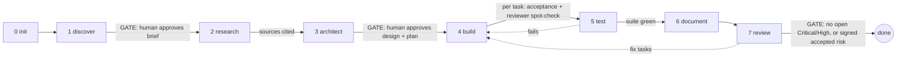

# eng-team

## 1. What it is

eng-team is a Claude Code plugin that acts as a full-lifecycle engineering team. An orchestrator (the "engineering lead") interviews you and challenges your assumptions, researches with citations, architects (options, ADRs, C4 diagrams), builds and tests behind gates or autonomously, writes layered docs, and reviews for security and compliance (EU first: GDPR, DORA, NIS2, AI Act, accessibility). It runs 14 agents with separated write rights, enforced by tool lists for the read-only roles and by prompts for the writers' folder scope. All state lives in your project under `.eng-team/`, so work can be resumed at any time. It can also run as a standalone review (`/eng-review`) with no setup that does not change lifecycle gates.



In `gated` mode the human gates are discover (brief), architect (design + plan) and review (final verdict). In `autonomous` mode those gates are approved by `agent` and recorded as assumptions and ADRs; hard stops still apply (section 8).

## 2. Install

**(a) Local plugin directory**

```
claude --plugin-dir /path/to/engineering-team/eng-team-plugin
```

**(b) Marketplace**

```
/plugin marketplace add Yakoub-ai/engineering-team
/plugin install eng-team@yakoub-ai
```

The repository is private, so you must be logged in with `gh auth login` using an account that has access to the Yakoub-ai organisation. For a private repository, also run `gh auth setup-git`; background plugin updates need a `GITHUB_TOKEN` in your environment.

**(c) Optional: context7 MCP.** The researcher uses the context7 MCP server (`resolve-library-id`, `query-docs`) for library and framework docs when it is installed. Without it, the researcher falls back to fetching vendor docs with WebFetch.

## 3. Use on claude.ai

claude.ai has no plugins, slash commands or subagents, only uploaded skills. The `skills/eng-team/` folder is self-contained, so it can run there with reduced isolation.

1. Build the zip: `bash eng-team-plugin/scripts/package-claude-ai.sh` (writes `eng-team-plugin/dist/eng-team-skill.zip`, top-level folder `eng-team/`).
2. In claude.ai go to Settings > Capabilities > Skills and upload the zip. Code execution must be enabled.
3. Start with a plain request: "use the eng-team skill to start a new project: ..." or "review this repo with eng-team". Intent is routed without slash commands.
4. Save and resume: files are written to `.eng-team/` and `docs/` in the code-execution workspace. Download them at each gate. To resume in a new chat, upload the whole `.eng-team/` and `docs/` folders (as a zip); the skill copies them into the workspace before reading state, then continues from state.md.

Differences from Claude Code:
- No context isolation: roles run one after another in the same conversation.
- No slash commands.
- No parallel reviewers.
- Builds and tests only run on code you upload; otherwise do those steps in Claude Code.

## 4. Set up for a new project

1. Open the project folder in Claude Code (with the plugin loaded). The folder can be empty or an existing repo.
2. Run `/eng-init`. It reads your manifests, IaC, CI files, README and `.env.example` and fills every profile field it can, marking each `# inferred: <file>`.
3. Answer the questions. You are asked only for required fields it could not infer, one per message, with a recommended default and a line on why it matters. Answers are marked `# stated`. "Don't know" is accepted for `regulated.nis2_entity` (stored as `unknown`). If nobody owns the project yet, `owner` becomes `unassigned` (only passes the gate in autonomous mode).
4. Check `.eng-team/profile.md`. It is the scope contract. Edit it directly, or tell the lead what to change. `/eng-init` also writes `.eng-team/state.md` (all 8 gates) and adds `.eng-team/.cache/` to `.gitignore`.
5. Optional: set `standards:` to your federation standards repo (a git URL or a local path; see section 6).
6. Commit `.eng-team/` (profile, state, packs, research notes, plan) so teammates and future sessions share the same scope and progress.
7. Run `/eng` to start the lifecycle (or any single `/eng-<phase>` command). `/eng` resumes from `current_phase`, so it is safe to run again after any interruption.

If `.eng-team/state.md` is missing, every phase command stops with: "This project isn't initialised for eng-team. Run `/eng-init` first." Only `/eng` (which runs init first), `/eng-init` and `/eng-review` work without it.

### Example profile (a production invoice API)

This is the profile of the `b-planted-api` test fixture, annotated. The trailing `# stated` / `# inferred: <file>` provenance comments that `/eng-init` adds are omitted here for readability.

```yaml
name: planted-api              # required. Used in docs and reports.
summary: Invoice API for small businesses  # required. One sentence: what it does, for whom. Seeds the brief.
owner: Test Owner              # required. Accountable person. Accepted risks must name a human, never "unassigned".
stage: production              # required. prototype|pilot|production|scale. production => full role checklists apply; needs-evidence items need owners; activates sre (stage >= pilot).
criticality: important         # required. low|important|critical. important => sre active; DORA question: does it support a critical/important function?
type: api-platform             # required. Matches the web stack pack (api-platform) and activates integration-engineer.
users: external-business       # required. internal|external-business|consumers|public-anonymous. Drives exposure and authZ depth.
tenancy: multi-tenant          # optional. multi-tenant => tester writes an authZ matrix (tenant A cannot touch tenant B); security checks tenant isolation.
data_classes: [personal, financial]  # required. personal => loads GDPR pack; financial + personal => compliance-officer deep mode, data-engineer money/integrity checks.
jurisdictions: [eu, se]        # required. eu => EU packs. A country code with no matching pack makes the researcher build an unreviewed project pack.
sector:                        # optional. Free text (insurance, public-sector, payments). Context for the researcher.
frameworks: []                 # optional. pci-dss, hipaa, soc2, iso27001... A value with no pack triggers research.
regulated:
  financial_entity: no         # required. yes => loads the DORA pack and activates deep SRE checks. no => DORA skipped.
  nis2_entity: unknown         # required. yes|no|unknown. yes/unknown (and not DORA) => loads the NIS2 pack, compliance deep mode.
  ai_act_role: none            # required. none|provider|deployer. Not none => loads the AI Act pack, activates ai-engineer, compliance deep mode.
  ai_high_risk_use: no         # optional. yes|no. Tightens AI Act checks.
residency: eu-only             # required. eu-only|eea|global|contract-specific. Checked by compliance-officer and platform-engineer (regions, subprocessors).
payments: via-psp              # optional. none|via-psp|stores-card-data. Not none => activates data-engineer and integration-engineer.
ai_usage: none                 # optional. none|llm-api|self-hosted-model|ml-predictions. Not none => activates ai-engineer.
stacks: [web]                  # required. azure|gcp|databricks|wordpress|web or free text. Selects stack packs; an unknown value (aws, sap-btp) makes the researcher build one.
deploy_target:                 # optional. Where it runs (e.g. Azure Container Apps). Context for platform-engineer.
has_ui: no                     # optional. yes => activates product-engineer and loads the accessibility pack.
autonomy: gated                # required. gated|autonomous. gated => human approves brief, design+plan, final verdict.
coaching: on                   # optional. on|brief. How much "why this matters" teaching the lead adds.
audiences: [engineers]         # optional. engineers|business|ops|compliance|executives. The tech-writer writes one doc per audience.
standards:                     # optional. Git URL or local path of the federation standards repo; empty = none.
priorities_override:           # optional. Default: security > compliance > data > reliability > ux > cost.
out_of_scope:                  # optional. Free text; reviewers do not flag these.
```

### Required vs optional fields

| Field | Required | Allowed values / notes |
|---|---|---|
| `name`, `summary`, `owner` | required | free text; `owner` may be `unassigned` only in autonomous mode |
| `stage` | required | prototype, pilot, production, scale |
| `criticality` | required | low, important, critical |
| `type` | required | internal-tool, data-pipeline, client-website, b2c-app, b2b-saas, api-platform, ml-system, other:<text> |
| `users` | required | internal, external-business, consumers, public-anonymous |
| `data_classes` | required | none, personal, special-category, financial, credentials, children, health |
| `jurisdictions` | required | `eu` plus country codes or others (uk, us, ...) |
| `regulated.financial_entity` | required | yes, no |
| `regulated.nis2_entity` | required | yes, no, unknown |
| `regulated.ai_act_role` | required | none, provider, deployer |
| `residency` | required | eu-only, eea, global, contract-specific |
| `stacks` | required | known: azure, gcp, databricks, wordpress, web; anything else is researched |
| `autonomy` | required | gated, autonomous |
| `tenancy`, `sector`, `frameworks` | optional | |
| `regulated.ai_high_risk_use` | optional | yes, no |
| `payments`, `ai_usage`, `deploy_target`, `has_ui` | optional | they still change which reviewers run, so fill them if true |
| `coaching`, `audiences` | optional | |
| `standards`, `priorities_override`, `out_of_scope` | optional | |

Required fields must be non-empty before the init gate passes. In gated mode `owner: unassigned`, or `unknown` in a field whose enum has no `unknown`, fails the gate.

## 5. What context each agent needs

The orchestrator passes every agent: absolute paths of the skill directory, its role file (`roles/<name>.md`), `shared/findings.md`, `.eng-team/profile.md`, `.eng-team/state.md`, the selected packs, plus the templates and challenger files the phase names, and a mode and scope (paths, plan task or diff range). Agents cannot spawn agents or talk to you; the lead runs every conversation. Agents that return content (researcher, architect, reviewers) never write; the lead saves their output.

Reviewers run in three modes: `plan` (during architect, on the design), `gate` (during build, on each task's diff) and `review` (the review phase, whole scope). Activation follows the profile: security, compliance and QA always; others per the matrix in `skills/eng-team/shared/project-profile.md`.

| Agent | Reads (files and profile fields) | Produces | Write rights | Phases |
|---|---|---|---|---|
| `eng-researcher` | profile, the open questions or missing pack needs, `templates/pack.md`, `challenger/citations.md`; profile `stacks`, `jurisdictions`, `frameworks`; official sources via web and context7 | Pack + Note blocks (optional `### Findings`), unreviewed project packs (`tier: project`, `status: unreviewed`, <= 60 lines) | none: tools `Read, Grep, Glob, WebFetch, WebSearch` + 4 context7 tools. Lead saves packs to `.eng-team/packs/<id>.md` | research; any phase with a pack miss |
| `eng-architect` | brief, profile (`stage`, `criticality`, `data_classes`, `jurisdictions`, `stacks`), packs in use, applicable `practices/*`, `challenger/devils-advocate.md`, `templates/architecture.md`, `templates/adr.md`, the existing repo | 2-3 options with trade-offs, C4 diagrams (Mermaid), ADR drafts with "Challenges raised", NFR targets, implementation plan | none: `Read, Grep, Glob`. Lead saves to `.eng-team/` and `docs/` | discover, architect |
| `eng-builder` | ONE plan task, the ADRs it cites, stack and practice packs, neighbouring code | code and tests for that task; `Status: DONE / BLOCKED / HARD-STOP` | `Read, Grep, Glob, Write, Edit, Bash` (source code, test-first) | build |
| `eng-tester` | brief, code, `practices/testing-pyramid.md`, profile `tenancy` | flow-to-test table, missing integration/contract/e2e/authZ tests, run results (date, commit, counts) | `Read, Grep, Glob, Write, Edit, Bash` | test |
| `eng-tech-writer` | all `templates/*`, profile `audiences`, ADRs, state.md, `.eng-team/test-results.md`, review findings, the code, and the commit sha given by the lead | `docs/` (brief, architecture, ADRs formatting, testing, runbook, `docs/compliance/evidence-log.md`, index), updated in place preserving human edits | `Read, Grep, Glob, Write, Edit` (no Bash; the only agent that writes `docs/`; the lead saves the brief, ADRs, architecture and review reports) | document |
| `eng-security-engineer` | role file, `shared/findings.md`, profile, state, selected packs (web/cloud stack, `practices/secure-sdlc.md`); code, config, CI | findings with `path:line` evidence (secrets redacted), severity, owner | `Read, Grep, Glob` | architect (plan), build (gate), review |
| `eng-compliance-officer` | same, plus compliance packs (GDPR, DORA, NIS2, AI Act, accessibility); profile `data_classes`, `jurisdictions`, `residency`, `regulated.*` | compliance findings quoting articles, evidence-log inputs | `Read, Grep, Glob` | architect (plan), build (gate), review |
| `eng-data-engineer` | same; profile `payments`, `data_classes`; schemas, migrations, pipelines | integrity, money/time/text, idempotency findings | `Read, Grep, Glob` | when a store, pipeline or payments exist |
| `eng-platform-engineer` | same; profile `deploy_target`, `residency`; IaC, CI/CD | IAM/network, deploy/rollback, backups/DR, cost findings | `Read, Grep, Glob` | when deployed beyond local |
| `eng-sre` | same; profile `stage`, `criticality`, `regulated.financial_entity`; logging/metrics config, runbooks | observability, alerting, incident-response findings | `Read, Grep, Glob` | `stage` >= pilot or `criticality` >= important |
| `eng-qa-engineer` | same; tests, CI | test strategy and authZ-test coverage findings | `Read, Grep, Glob` | always |
| `eng-integration-engineer` | same; profile `payments`, `type`; API and webhook code | API, webhook, OAuth, third-party resilience, billing/VAT findings | `Read, Grep, Glob` | APIs, webhooks, OAuth or payments |
| `eng-ai-engineer` | same; profile `ai_usage`, `regulated.ai_act_role` | prompt-injection, data-in-prompts, agent permission, eval, spend findings | `Read, Grep, Glob` | `ai_usage` != none |
| `eng-product-engineer` | same; profile `has_ui`, `audiences` | UX states, WCAG, i18n, notification findings | `Read, Grep, Glob` | `has_ui: yes` or user-facing email |

The orchestrator itself holds `roles/lead-architecture.md` (its own review checks) and is the only writer of `.eng-team/state.md`. If subagents are not available (claude.ai), roles run sequentially in one conversation, with a notice that the run is not context-isolated.

## 6. Federation setup

A federation standards repo lets an organisation share packs and conventions across projects.

```
my-standards/
  packs/              # reviewed packs (tier: federation), one <id>.md each
  conventions.md      # org conventions the lead reads
  priorities.md       # org priority order, if different from the default
```

Point a project at it with `standards:` in `.eng-team/profile.md`: a local path, or a git URL. A URL is cloned read-only with `git clone --depth 1` into `.eng-team/.cache/standards/` (gitignored); in gated mode you are asked once before the first clone. If it is unreachable the lead warns once, logs `standards-unavailable`, and continues with plugin packs only. It never claims federation packs were loaded when they were not.

**Precedence** (per pack `id`): project (`.eng-team/packs/`), then federation (`<standards>/packs/`), then plugin (`stacks/`, `compliance/`, `practices/`). The first pack whose `applies_when` evaluates true wins.

**Promotion** with `/eng-promote <pack-id>`: refuses if the project pack has no `reviewed_by`; checks every source URL resolves; resolves `standards` to a local path; writes `<standards>/packs/<id>.md` as `tier: federation`, `status: reviewed`. It then prints the git steps (`git checkout -b promote/<id>`, `git add`, `git commit`, open a PR). It never commits, pushes or opens a PR itself.

## 7. Commands

All commands also work in the namespaced form `/eng-team:<cmd>` (for example `/eng-team:eng-init`).

| Command | Arguments | What it does |
|---|---|---|
| `/eng` | `[--autonomous\|--gated] [what you want to build or change]` | Runs the full lifecycle from `current_phase` (init first if there is no state) |
| `/eng-init` | `[--autonomous] [project notes]` | Creates `.eng-team/profile.md` and `state.md`; if `.eng-team/` exists, checks integrity and reports |
| `/eng-discover` | `[--force "<reason>"] [--skip "<reason>"] [--autonomous\|--gated] [notes]` | Interview and challenge; writes the brief |
| `/eng-research` | same | Researches open questions and pack gaps with citations |
| `/eng-architect` | same | Options, ADRs with devil's-advocate, C4, plan; reviewers in `plan` mode |
| `/eng-build` | same | Builds the plan one task at a time, test-first, with a reviewer spot-check |
| `/eng-test` | same | Maps critical flows to tests, writes missing ones, runs the suite |
| `/eng-document` | same | Writes or updates `docs/` in place |
| `/eng-review` | `[plan\|review\|gate] [paths or diff range]` | Standalone review/audit; never changes lifecycle gates; works without setup |
| `/eng-promote` | `<pack-id>` | Promotes a reviewed project pack to the federation repo (local copy only) |

A phase command refuses unless every earlier gate is `passed`, `skipped` or `forced`, and names the blocking gate. `--force "<reason>"` runs it anyway (earlier gates become `forced`, logged; a reason is mandatory). `--skip "<reason>"` marks a gate skipped and is only allowed in gated mode.

## 8. Autonomy and hard stops

- `gated` (default): stop for human approval at discover (brief), architect (design + plan) and review (final verdict). Approver name and date go in the Gates table.
- `autonomous`: no approval stops. `Approved by: agent`; decisions become ADRs with `Decided by: agent`; interview questions become Assumptions rows.

Hard stops apply in both modes. The gate becomes `failed`, a `hard-stop` line is logged, and the lead asks you how to proceed:

1. A Critical finding (after the unreviewed-pack cap; findings from an unreviewed pack are capped at High unless they quote a regulation article verbatim). It never loops automatically: you choose fix or accept the risk, and only a named human can accept.
2. A test suite not fixed within 2 attempts.
3. Destructive operations: data migrations, deletions, production deploys.
4. Any action outside the repository.

Loops run at most 3 iterations, then escalate to you. Default priorities when roles conflict: security > compliance > data integrity > reliability > user experience > cost (overridable with `priorities_override`).

## 9. Packs

A pack is a markdown file with frontmatter and a body of at most 60 lines, based on `skills/eng-team/templates/pack.md`:

```yaml
id: web                       # unique per tier
kind: stack                   # stack | compliance | practice
status: reviewed              # reviewed | unreviewed | deprecated
tier: plugin                  # plugin | federation | project
sources: [{title, url, accessed}]
reviewed_by: George Yakoub   # empty until a human reviews it
review_by: 2027-04-15        # staleness date
applies_when: profile.stacks contains "web" OR profile.has_ui == "yes"
```

- **Tiers and precedence:** project, then federation, then plugin.
- **`applies_when`:** the literal `always`, or an expression over real `profile.<field>` names using `==`, `!=`, `contains`, `AND`, `OR`, `NOT`, parentheses and double-quoted strings.
- **Adding one:** if a profile `stacks`, `jurisdictions` or `frameworks` value matches no pack, the researcher builds one automatically (`unreviewed`, every bullet cited) and the lead saves it to `.eng-team/packs/<id>.md`. To write one by hand, copy `templates/pack.md` into `.eng-team/packs/`.
- **Reviewing one:** read it against its sources, fix it, then set `reviewed_by` to your name and `status: reviewed`. Unreviewed packs are flagged in state.md and their findings are capped at High.
- **Promoting:** `/eng-promote <pack-id>` (section 6).
- **Staleness:** the lead reports packs past `review_by`. Re-research and update the date.

## 10. Testing this plugin

```
bash eng-team-plugin/tests/validator/test_validate.sh   # validator self-tests: ALL VALIDATOR TESTS PASSED
bash eng-team-plugin/scripts/validate.sh eng-team-plugin  # structure check: exit 0, no output
claude plugin validate eng-team-plugin                  # manifest and component check
cd eng-team-plugin && claude plugin eval . --model sonnet --ablation none --runs 1 --concurrency 1 \
  --no-publish --trust-plugin --scaffold --allow-tools Bash Write Edit --max-cost-usd 6
```

`validate.sh` checks frontmatter, pack fields, `applies_when` field names, file references from SKILL.md, phases and commands, and that agent tool lists match the write rights. CI runs both validator commands. The eval suite (8 cases, see `tests/evals/README.md`) uses LLM graders and is noisy; re-run a failing case once before changing anything.

## 11. Limits

What this team cannot do: live penetration testing; verifying runtime or cloud configuration that is not in the repository (unless you grant read access); legal sign-off; anything that requires human attestation. Controls that cannot be verified from code (tested restores, pen tests, on-call, access reviews, signed DPAs) are reported as `needs-evidence` with an owner role, never assumed. Every report has a "Not covered" section. The output supports decisions; it does not certify compliance.
