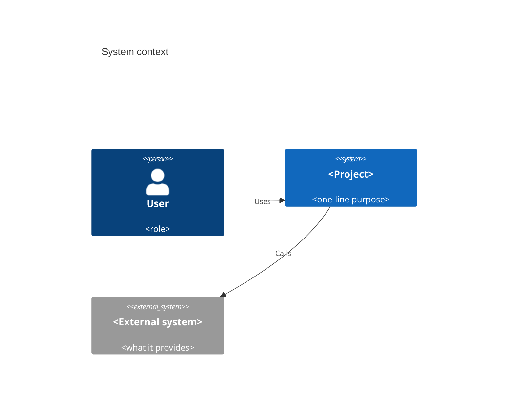
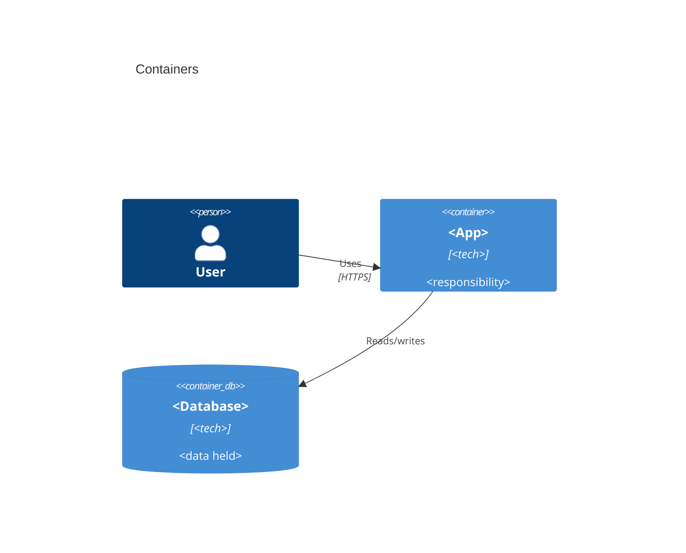

# <Project> — Architecture

Audience: engineers and technical reviewers
Last verified against: <commit sha>

## Context (C4 level 1)
<!-- guidance: one mermaid C4Context diagram (up to 25 lines) showing the system, its users and external systems, plus 2-3 lines of prose. Whole document stays within 180 lines. -->

## Containers (C4 level 2)
<!-- guidance: one mermaid C4Container diagram (up to 35 lines) showing deployable units, data stores and their protocols, plus a short note on technology choices. -->

## Key flows
<!-- guidance: at most 3 mermaid sequence diagrams (up to 20 lines each), one per critical flow such as sign-in, main write path, or payment. -->

## Quality attributes
<!-- guidance: table with columns attribute, target, how met, evidence. Up to 10 rows; cover security, availability, performance, privacy and cost where relevant. Evidence is a path:line or test reference. -->

| Attribute | Target | How met | Evidence |
|---|---|---|---|

## Decisions
<!-- guidance: one bullet per ADR, linking to its file with a one-line summary. Up to 15 lines. -->
