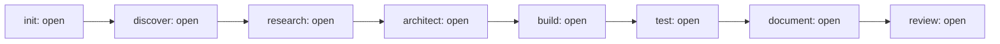

# <Project> — Status

Audience: the human owner and sponsors
Last verified against: <commit sha>
<!-- guidance: rewritten (not appended) at every gate. Whole document stays within 60 lines. -->

## Phases
<!-- guidance: Mermaid flowchart of the eight phases with their status, as in docs/engineering/team-plan.md. -->

## Gates
| Phase | Status | Approved by | Date |
|---|---|---|---|

## Current focus and next action
<!-- guidance: the current phase, what is happening, and the single next action (and who takes it). -->

## Open questions
<!-- guidance: the count from docs/engineering/questions.md, then the top 3 as "Q-n: question". -->

## Open Critical and High findings
<!-- guidance: count, then finding IDs with one line each, or "none". -->

## Security audit
<!-- guidance: latest audit date and commit from state.md Security audits, and the Next due date. -->

## Environment health
<!-- guidance: one line from the last setup check: tools present, outdated or missing. -->

## Links
<!-- guidance: latest handover (docs/engineering/handovers/NN-<phase>.md) and the team plan (docs/engineering/team-plan.md). -->
