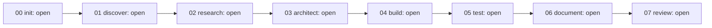

# <Project> — Team plan

Audience: the human owner and sponsors
Last verified against: <commit sha>

## Phases
<!-- guidance: a Mermaid flowchart of the eight phases with the current status. Status values: open | in-progress | passed | failed | forced | skipped. Update the status of each node at every gate. -->

## Plan per phase
<!-- guidance: one row per phase. Agents: name each agent and, for reviewers, say why it is on or off using the activation matrix in shared/project-profile.md (for example "eng-sre: on, stage is pilot" or "eng-ai-engineer: off, ai_usage is none"). Inputs and Outputs are paths. You will be asked: the questions and approvals the human will see. Hard-stop risks: what would stop the run (Critical finding, failing suite, destructive or outside-repository action). -->

| Phase | Agents | What they do | Inputs | Outputs (paths) | You will be asked | Hard-stop risks |
|---|---|---|---|---|---|---|
| init | | | | | | |
| discover | | | | | | |
| research | | | | | | |
| architect | | | | | | |
| build | | | | | | |
| test | | | | | | |
| document | | | | | | |
| review | | | | | | |

## What will not be done
<!-- guidance: out of scope items, and the human-only actions (destructive operations, production deploys, anything outside the repository). One bullet each. -->
