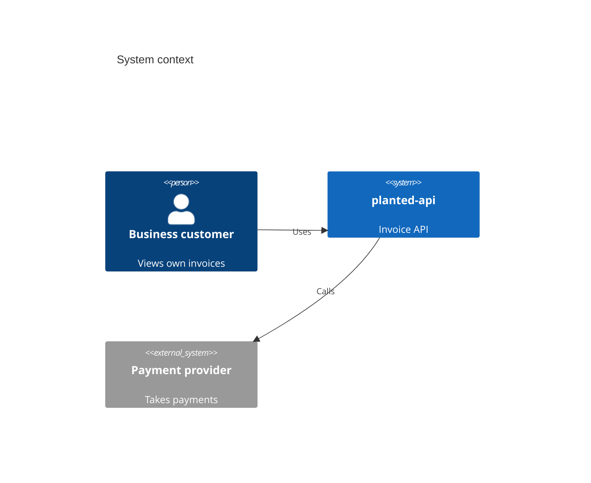
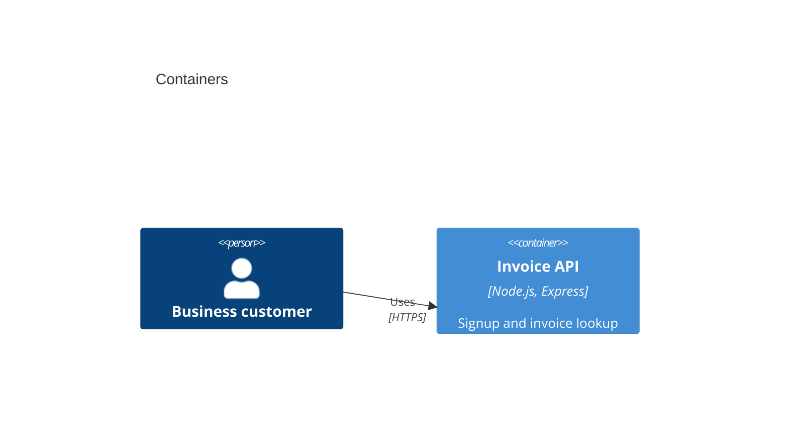

# planted-api — Architecture

Audience: engineers and technical reviewers
Last verified against: 0000000

## Context (C4 level 1)

## Containers (C4 level 2)

## Quality attributes

| Attribute | Target | How met | Evidence |
|---|---|---|---|
| Security | Users see only own invoices | Authenticated lookup | src/server.js |

## Decisions
- None recorded yet.
